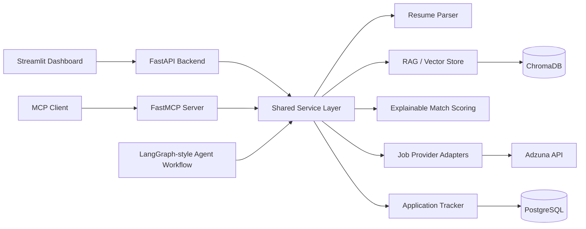

# JobPilot AI

Agentic AI Job Search Copilot for discovering fresh jobs, matching resumes with explainable evidence, drafting grounded recruiter outreach, and tracking applications.

This repository is designed as an AI engineering portfolio project. It demonstrates backend architecture, MCP tools, RAG-style retrieval, structured outputs, deterministic scoring, external provider adapters, and a usable Streamlit dashboard.

## Core Features

- **AI Resume Matcher:** Parses resumes, extracts skills and evidence, analyzes job requirements, and produces a transparent 0-100 match report.
- **Fresh Job Finder MCP:** Uses a provider adapter for Adzuna live search when credentials are configured, with clearly labeled demo data when credentials are absent.
- **AI Outreach Assistant:** Generates recruiter emails from verified resume evidence and flags unverified claims.
- **Application Tracker:** Tracks saved jobs, statuses, follow-ups, history, duplicate URLs, and analytics.

## Architecture



The production dependency list includes FastAPI, SQLAlchemy, PostgreSQL, MCP Python SDK/FastMCP, Anthropic/OpenAI provider hooks, LangGraph, Sentence Transformers, ChromaDB, Streamlit, PyTest, Docker, and Ruff. The core tests use deterministic local services so CI does not require paid API calls.

## MCP Tool Catalog

Resume matching:

- `parse_resume`
- `analyze_job_description`
- `match_resume_to_job`
- `identify_skill_gaps`
- `suggest_resume_improvements`

Outreach:

- `draft_recruiter_email`
- `generate_email_variations`
- `draft_followup_email`
- `validate_email_claims`
- `create_gmail_draft`

Tracker:

- `save_job`
- `track_application`
- `update_application_status`
- `get_application_pipeline`
- `get_due_followups`
- `get_application_analytics`

Job finder:

- `search_fresh_jobs`
- `filter_jobs`
- `rank_jobs_by_resume`
- `get_job_details`
- `save_matched_jobs`
- `find_duplicate_jobs`

## Setup

```bash
cd jobpilot-ai
python3.11 -m venv .venv
source .venv/bin/activate
python -m pip install -e ".[dev]"
cp .env.example .env
```

Configure live integrations in `.env`:

- `ADZUNA_APP_ID` and `ADZUNA_APP_KEY` for live job search.
- `ANTHROPIC_API_KEY` for Claude-backed generation.
- `OPENAI_API_KEY` if using the optional OpenAI adapter.
- `GMAIL_CLIENT_SECRET_FILE` for OAuth draft creation.

No secrets are required for demo mode.

## Run Locally

Start the API:

```bash
uvicorn app.api.main:app --reload
```

Start Streamlit:

```bash
streamlit run frontend/streamlit_app.py
```

Run the MCP server over stdio:

```bash
python -m app.mcp_server.server
```

Run the agent demo:

```bash
python scripts/run_demo.py
```

Run Docker:

```bash
docker compose up --build
```

## Testing

```bash
pytest
ruff check .
```

The suite covers resume parsing logic, skill extraction, job requirement extraction, match scoring, skill gaps, date filtering, experience filtering, salary filtering, duplicate detection, application tracking, email claim validation, MCP tool functions, the agent workflow, and retrieval isolation.

If the environment does not have dependencies installed, run `python -m pip install -e ".[dev]"` first.

## API Examples

```bash
curl http://localhost:8000/health
```

```bash
curl -X POST http://localhost:8000/match \
  -H "Content-Type: application/json" \
  -d '{"resume_text":"Built Python FastAPI services with PostgreSQL and RAG.","job_description":"Requires Python, FastAPI, PostgreSQL, and ChromaDB.","job_title":"AI Backend Engineer"}'
```

## Demo Mode

Demo mode uses fictional job postings in `app/providers/demo_jobs.py`. Results are labeled with `source="demo"` and must not be presented as live jobs. Live Adzuna search is available through the provider adapter once credentials are configured.

## Security

- API keys are loaded from environment variables.
- Resume documents and job descriptions are treated as untrusted input.
- Gmail draft creation requires explicit authorization and OAuth setup.
- No code path sends emails or submits job applications automatically.
- The MCP server should not be exposed publicly without authentication and access controls.
- `.gitignore` excludes credentials, local databases, uploads, caches, and private sample data.

## Current Limitations

- The included vector store is a deterministic local fallback for tests and demos; production deployment should enable ChromaDB plus Sentence Transformers.
- The repository includes SQLAlchemy/PostgreSQL models, but the in-memory tracker powers the local demo until migrations are added.
- Gmail draft creation is a guarded stub until OAuth credentials are configured.
- Live job search requires Adzuna credentials.
- The agent workflow is bounded and deterministic in demo mode; LangGraph is included as the intended production orchestration dependency.

## Evaluation

`tests/evals/test_retrieval_eval.py` checks that relevant resume evidence can be retrieved for a query and that data is isolated by user id. The project avoids claiming hallucination-free behavior; email drafts include the evidence used and a list of unverified claims.

## Portfolio Copy

GitHub repository description:

> Agentic AI Job Search Copilot with FastAPI, MCP tools, RAG-style resume retrieval, explainable match scoring, job provider adapters, Streamlit, Docker, and tests.

GitHub topics:

`ai-engineering`, `mcp`, `fastapi`, `streamlit`, `rag`, `langgraph`, `python`, `job-search`, `semantic-search`, `portfolio-project`

Resume bullets:

- Built JobPilot AI, an agentic job-search copilot with FastAPI, MCP tools, RAG-style resume retrieval, explainable scoring, recruiter outreach generation, and application tracking.
- Implemented modular Python services with provider adapters, deterministic tests, Docker, CI, and guarded external integrations for Adzuna job search and Gmail draft creation.

60-second interview explanation:

> JobPilot AI is a portfolio project that shows how I design AI applications beyond a single LLM call. A resume is parsed into structured evidence and searchable chunks, job descriptions are analyzed into required and preferred skills, and the match score is computed by a transparent weighted algorithm. MCP tools expose the same capabilities to agent clients, while FastAPI and Streamlit provide the backend and demo UI. The job finder uses an Adzuna adapter for live search when credentials are available and a clearly labeled demo provider otherwise. The outreach assistant only drafts claims grounded in resume evidence and flags risky claims. I added tests for matching, filtering, tracking, retrieval, MCP tool execution, and the agent workflow so the core behavior is reproducible without paid APIs.

LinkedIn announcement:

> I built JobPilot AI, an agentic AI job-search copilot that combines FastAPI, MCP tools, RAG-style resume retrieval, explainable resume-to-job matching, fresh job search adapters, recruiter outreach generation, and a Streamlit dashboard.
>
> The project focuses on practical AI engineering patterns: shared service logic across API/MCP/UI layers, guarded side effects, deterministic tests, demo mode for missing credentials, and clear documentation for live integrations.

## Publishing

GitHub CLI was not available in the initial environment check. To publish manually:

```bash
git init
git add .
git commit -m "Initial commit: build JobPilot AI"
git branch -M main
git remote add origin https://github.com/<your-username>/jobpilot-ai.git
git push -u origin main
```

Create the public repository named `jobpilot-ai` on GitHub before pushing, or install/authenticate `gh` and run:

```bash
gh repo create jobpilot-ai --public --source=. --remote=origin --push
```

